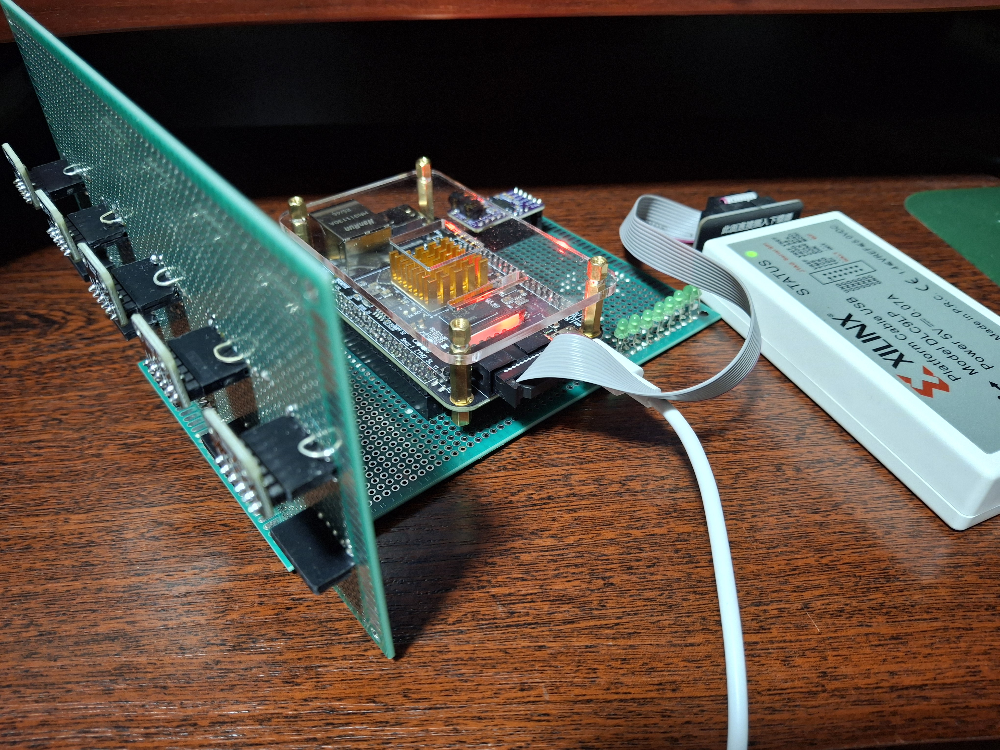

# acoustic_beamformer
# Acoustic Beamformer — Акустична система спрямованого приймання звуку на FPGA

**Курсовий проєкт із розробки цифрових систем на FPGA**

## 1. Опис проєкту

Проєкт присвячений розробці цифрової системи спрямованого приймання та обробки акустичних сигналів на базі програмованої логіки FPGA Xilinx Zynq-7020.

Система використовує лінійний масив із **5 цифрових MEMS-мікрофонів ICS-43434**, сигнали яких обробляються паралельно з використанням алгоритму цифрового формування діаграми спрямованості (Digital Beamforming).

Основна мета — реалізувати акустичну антену з можливістю електронного керування напрямком максимальної чутливості без механічного переміщення мікрофонного масиву.

Для формування діаграми спрямованості використовується алгоритм затримки та підсумовування сигналів (Delay-and-Sum Beamforming).

Обробка аудіоданих виконується апаратно в програмованій логіці FPGA, що забезпечує паралельність обчислень, детерміновані часові характеристики та малу затримку обробки.

## 2. Апаратна платформа

| Компонент | Характеристика |
|---|---|
| FPGA | Xilinx Zynq-7020 |
| Середовище розробки | AMD Xilinx Vivado |
| Мікрофони | ICS-43434 |
| Кількість мікрофонів | 5 |
| Інтерфейс мікрофонів | I2S |
| Розрядність аудіоданих | 24 біти |
| Конфігурація масиву | Лінійна, 5 мікрофонів |
| Відстань між мікрофонами | 30 мм |
| Загальна довжина між крайніми мікрофонами | 120 мм |
| Обробка сигналів | Програмована логіка FPGA |
| Аудіовихід | I2S |
| Індикація рівня сигналу | 8 світлодіодів |

## 3. Конфігурація мікрофонного масиву

У початковій конфігурації використовується лінійний масив із п'яти мікрофонів, розташованих уздовж однієї осі.

Відстань між сусідніми мікрофонами становить 30 мм. Відстань між центрами крайніх мікрофонів — 120 мм.

Така геометрія дозволяє досліджувати просторову вибірковість акустичної системи та формувати керовану діаграму спрямованості в площині, що містить вісь мікрофонного масиву.

Лінійний масив не забезпечує однозначного визначення просторового напрямку джерела звуку в тривимірному просторі.

Геометрія масиву враховується під час обчислення часових затримок для кожного мікрофонного каналу.

## 4. Принцип роботи

Робота системи ґрунтується на алгоритмі Delay-and-Sum Beamforming.

Звукова хвиля, яка надходить із певного напрямку, досягає різних мікрофонів із різними часовими затримками.

Для компенсації цих затримок кожен цифровий сигнал додатково затримується на розраховану величину.

Після вирівнювання сигналів виконується їх підсумовування.

Вихідний сигнал визначається виразом:

\[
y[n]=\frac{1}{5}\sum_{i=0}^{4}x_i[n-D_i]
\]

де:

- \(x_i[n]\) — цифровий сигнал i-го мікрофона;
- \(D_i\) — програмована затримка відповідного каналу;
- \(y[n]\) — результуючий сигнал акустичної антени.

Зміна набору затримок дозволяє електронним способом змінювати напрямок максимальної чутливості мікрофонного масиву.

## 5. Функціональні модулі системи

### 5.1. Приймання цифрових аудіоданих

Для приймання сигналів MEMS-мікрофонів використовується інтерфейс I2S.

Модулі приймання забезпечують синхронізацію, перетворення послідовного потоку даних у паралельні PCM-відліки та передачу аудіоданих до блоків цифрової обробки.

### 5.2. Цифрова фільтрація

Перед формуванням діаграми спрямованості передбачається використання цифрових фільтрів для обмеження робочого частотного діапазону.

Для експериментальної конфігурації розглядається верхня гранична частота приблизно 6 кГц.

Фільтрація дозволяє зменшити вплив високочастотних складових, для яких просторова дискретизація мікрофонного масиву може спричиняти появу додаткових максимумів діаграми спрямованості.

### 5.3. Програмовані лінії затримки

Кожен із п'яти мікрофонних каналів використовує індивідуальну цифрову лінію затримки.

Величина затримки визначається геометричним положенням мікрофона, напрямком приймання та частотою дискретизації.

Програмовані затримки забезпечують формування необхідної діаграми спрямованості.

### 5.4. Формування результуючого сигналу

Після часової компенсації сигнали п'яти мікрофонів підсумовуються.

Для запобігання переповненню розрядної сітки та забезпечення необхідного динамічного діапазону використовується масштабування результату.

### 5.5. Передавання аудіосигналу

Оброблений цифровий сигнал передається через вихідний інтерфейс I2S.

Це дозволяє підключати зовнішній аудіокодек або цифро-аналоговий перетворювач для прослуховування сигналу.

### 5.6. Індикація рівня сигналу

Для візуального контролю амплітуди результуючого сигналу передбачено восьмирозрядний світлодіодний індикатор.

Індикатор відображає пікове значення амплітуди з періодичним скиданням приблизно двічі на секунду.

## 6. Програмні засоби

Для розробки та перевірки системи використовуються:

- AMD Xilinx Vivado — створення проєкту, синтез і реалізація цифрової схеми;
- Verilog HDL — опис цифрових апаратних модулів;
- Vivado Simulator (XSim) — функціональне моделювання;
- Xilinx Zynq-7000 — апаратна платформа реалізації.

## 7. Структура репозиторію

Репозиторій містить проєкт Vivado та вихідні файли цифрової системи.

Основні компоненти:

- `Acoustic_beamformer.xpr` — основний файл проєкту Vivado;
- `Acoustic_beamformer.srcs/sources_1` — вихідні HDL-модулі;
- `Acoustic_beamformer.srcs/sim_1` — файли моделювання;
- `Acoustic_beamformer.srcs/constrs_1` — файли обмежень і призначення виводів;
- `README.md` — документація проєкту.

Тимчасові файли Vivado, кеш, результати синтезу та моделювання не включаються до репозиторію.

## 8. Відкриття та компіляція проєкту

Для роботи з проєктом необхідно:

1. Встановити сумісну версію AMD Xilinx Vivado.
2. Клонувати репозиторій GitHub на локальний комп'ютер.
3. Відкрити файл `Acoustic_beamformer.xpr`.
4. Перевірити налаштування цільової FPGA та шляхи до вихідних файлів.
5. За необхідності згенерувати вихідні продукти IP-блоків.
6. Виконати синтез (Run Synthesis).
7. Виконати реалізацію (Run Implementation).
8. Згенерувати конфігураційний файл FPGA (Generate Bitstream).

Перед завантаженням конфігурації на апаратну платформу необхідно перевірити відповідність призначених виводів реальній платі.

## 9. Мета та завдання курсової роботи

Метою курсової роботи є дослідження можливостей FPGA для реалізації багатоканальної цифрової обробки акустичних сигналів.

Основні завдання:

1. Дослідити принципи роботи цифрових MEMS-мікрофонів та інтерфейсу I2S.
2. Розробити модулі приймання п'яти каналів аудіоданих.
3. Реалізувати програмовані цифрові лінії затримки.
4. Реалізувати алгоритм Delay-and-Sum Beamforming.
5. Забезпечити формування цифрового вихідного аудіосигналу.
6. Реалізувати індикацію рівня сигналу.
7. Провести функціональне моделювання розроблених модулів.
8. Дослідити залежність діаграми спрямованості від геометрії масиву, частоти сигналу та встановлених затримок.

## 10. Подальший розвиток

Можливі напрямки розвитку системи:

- реалізація дробових часових затримок;
- програмне керування напрямком приймання;
- автоматичне визначення напрямку джерела звуку (DOA);
- адаптивне формування діаграми спрямованості;
- цифрова фільтрація сигналів;
- використання ARM-процесора Zynq для керування параметрами обробки;
- автоматичне акустичне відстеження джерела звуку;
- експериментальне вимірювання діаграми спрямованості;
- розширення мікрофонного масиву для двовимірного керування напрямком.

## 11. Стан проєкту

**Стан:** розробка та експериментальна перевірка в межах курсової роботи.

Проєкт призначений для дослідження алгоритмів цифрового формування діаграми спрямованості та особливостей реалізації п'ятиканальної обробки аудіосигналів на FPGA.

## 12. Використана література

1. AMD Xilinx. *Vivado Design Suite User Guides*.
2. AMD Xilinx. *Zynq-7000 SoC Technical Reference Manual (UG585)*.
3. TDK InvenSense. *ICS-43434 Digital MEMS Microphone Datasheet*.
4. Van Trees H. L. *Optimum Array Processing*.
5. Johnson D. H., Dudgeon D. E. *Array Signal Processing: Concepts and Techniques*.

